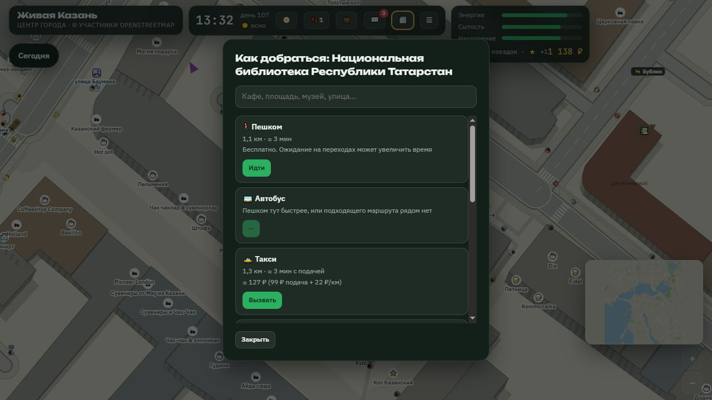
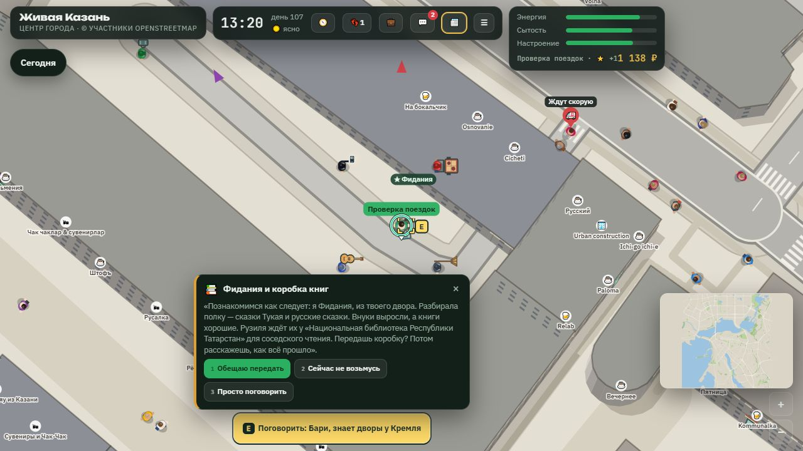

# Пакет «Городская жизнь»: история, жители, поездки и читаемость

Дата: 27.10.2026. Ветка: `codex/city-life-reliable`. Исходная база и сравнение скорости: `50c92a4`; перед сдачей пакет совмещён с `8aef086` (240 жителей и новые ориентиры команды).

Пакет связывает одну законченную историю Фидании с настоящим перемещением по карте, исправляет потерю жителей и целей поездки, добавляет детали крупного плана. Это локальная работа для ревью: слияние и развёртывание не выполнялись.

## Согласованный объём

Исходное разделение в `docs/DEV3.md` ограничивало работу графикой. Для этого пакета пользователь отдельно согласовал исправления игровой логики и одну законченную казанскую историю. Поэтому изменения в `main.js`, жителях, транспорте и прокурорском сюжете входят в текущую задачу; это не только визуальная правка. Старое разделение ответственности остальных задач не переписывалось.

| Часть | Изменения и файлы |
|---|---|
| История соседки | Новый `site/js/neighbour-story.js`: знакомство, обещание, доставка, личная благодарность и реакция на следующий игровой день. Подключение и доступ из меню — `site/zhivaya-kazan.html`, `main.js`; факты для разговора — `folk.js`. |
| Постоянные жители | `folk.js`, `folk-acts.js`, `companion.js`: сохранение личности между улицей, интерьером, сопровождением и работой водителем; защита от старых ответов поиска пути и действий. |
| Поездка целиком | Новый `journey.js`; `transport.js`, `vehicles.js`, `main.js`, `agents.js`, `sit-transport.js`: подход, настоящая посадка, поездка, высадка, последний пеший участок, отмена и сохранение. |
| Прокурор | `prosecutor.js`: проверка актуальности штрафа и визита, явный приём вместо автоматического перехода сюжета, сохранение помощи журналиста до завершения истории. |
| Отрисовка | `render.js`: крупный план жителей и предметов, велосипед, остановки и входы в кафе, ограниченные детали фасадов, подсказки посадки/высадки и положение E. |
| Проверки | Семь файлов `*.test.js`, обновлённые браузерные `prosecutor.js`, `shots.js`, `perf.js`, общие `visual-fixtures.js` и `render-metrics.js`; список и команды — `tools/tests/README.md`. |

Сервер, сетевой протокол, платные API, ключи, исходные данные жителей и карта в этот пакет не входят. Новых библиотек и загружаемых графических ресурсов нет. Снимки в `docs/media/city-life` нужны только для ревью и не загружаются игрой.

Сравнение близкого плана: [до](media/city-life/before-detail.jpg), [после](media/city-life/desktop-detail.jpg). [Навигатор 390×844](media/city-life/phone-transport.jpg), [исходные замеры](media/city-life/performance.json).

Браузерные проверки используют тестовые позиции для отдельных встреч и ускоренные шаги настоящего движка для пути велосипеда. Полный проход выполнялся с первоначально выбранной технической библиотекой; затем отдельно проверены приоритет Национальной библиотеки и удержание собеседницы на время чтения.

## Что должен увидеть игрок

### Фидания и коробка книг

Постоянная жительница `fidania` предлагает передать коробку сказок Тукая и русских сказок знакомой у библиотеки. Начать и принять обещание можно только при личной встрече через E. Пункт «История соседки» в меню показывает текущий шаг и предлагает маршрут; он не позволяет согласиться или получить награду издалека.

Место выбирается среди существующих библиотек на загруженной карте. Публичная библиотека имеет приоритет перед технической или ведомственной коллекцией; сохраняются настоящее название места и доступная пешеходная точка рядом. Сама встреча с Рузилей и соседское чтение — вымышленная история, а не заявление о программе реальной библиотеки. Если подходящего места нет, обещание пока не принимается.

Маршрут открывает обычный выбор транспорта. Доставка требует добраться до точки, выйти из транспорта, нажать E и подтвердить помощь: тратится 6 энергии. Само прибытие или кнопка издалека книги не передают. При нехватке энергии коробка остаётся у игрока.

После доставки нужно лично рассказать Фидании. Благодарность выдаётся один раз: +1 еда в запасе, +7 настроение, +1 репутация. При встрече на следующий игровой день появляется отдельная реакция без повторной награды. Обещание, место, доставка, благодарность и реакция сохраняются в `PROG.neighbourStory`; факты попадают в контекст разговора через `neighbourStoryContext(id)`.

Можно отказаться без штрафа, позже передумать либо лично вернуть коробку. Реального таймера истечения нет. Активная личная карточка временно удерживает именно собеседницу: её текущий путь отменяется, расписание продолжится после закрытия карточки. Журнал из меню и карточка в очереди не удерживают жителя; проверки расстояния сохраняются.

### Жители и прокурор

Не найденный путь больше не считается прибытием. Житель остаётся в настоящей позиции, повторяет поиск позднее; запоздавший callback старого маршрута не меняет новую поездку. Короткое соединение с маршрутом проходится ногами с учётом препятствий. Собеседник в интерьере, спутник и водитель используют одну постоянную личность; обновление расписания не должно создавать копию или забирать человека во время взаимодействия.

В прокурорском сюжете старая карточка жалобы повторно проверяет штраф, срок и исход предыдущей жалобы. Повторного возврата денег нет; сначала погашается соответствующий долг. Действие приёма действительно только у стола в том же посещении. Переход проверки требует явного приёма и больше не происходит сам после ожидания в комнате. Помощь журналиста действует на обоих соответствующих шагах, включая старые сохранения, и заканчивается вместе с историей.

### Поездка и сохранение

Выбор маршрута связывает подход к транспорту, посадку по E, поездку и остаток пути пешком. Велосипед движется в настоящем цикле транспорта по пешеходному графу, а не переносит игрока к цели. Его тариф — 20 ₽ за старт и 3 ₽ за игровую минуту. Самокат, каршеринг, своя машина, такси и существующие автобусные маршруты используют тот же конечный пункт.

Перед посадкой повторно проверяются наличие транспорта, расстояние и возможность построить проезжаемый путь. Невозможный путь не списывает стартовую плату. Такси можно сесть только когда оно действительно приехало и находится рядом; отменённый вызов не восстанавливается поздним ответом. После высадки водитель освобождается, а игрок продолжает пешком к цели. Успешное переназначение маршрута кликом по карте обновляет цель; неудачное сохраняет прежнюю.

Автобусный подбор учитывает реальные пешеходные подходы, не отбрасывает все варианты из-за одной недоступной остановки и повторно использует результаты поиска для общих остановок. Новые пересадки или общегородской планировщик транспорта не добавлены.

При сохранении активной поездки записываются цель и сумма к оплате на момент снимка. После загрузки старая машина или автобус не воссоздаются: сохранённый счёт закрывается, игрок оказывается пешком и может выбрать свежий транспорт к прежней цели. За время вне игры аренда не начисляется. Повторная обработка того же загруженного снимка не списывает счёт ещё раз; следующее сохранение содержит уже прерванную поездку без старого долга за неё. Если наличных не хватает, остаток записывается в игровой долг, а не исчезает.

## Графика и ограничение нагрузки

Дополнительные фасады, входы кафе, крыши/скамейки остановок и детали жителей используются на крупном плане (`LOD 2`, масштаб больше 8). Дальние силуэты сохраняют дешёвую отрисовку. Велосипед отличается от машины и самоката; подсказка E удерживается в окне и проверяется на пересечение с подписью игрока.

Бюджеты проверяются отдельно от внешнего вида:

- не более двух детализированных стен здания и 48 стен за кадр;
- кэш геометрии входов кафе ограничен 96 записями, за один проход определяются не более двух новых входов;
- кэш пяти значков транспорта переиспользуется: 32 000 байт RGBA-пикселей, без учёта служебных расходов Canvas;
- одновременно рисуется не более восьми коротких эффектов посадки/высадки; они не создают отдельного цикла анимации, учитывают уменьшение движения;
- для каждого велосипеда или фасада отдельный растровый холст не выделяется.

Эти границы не являются замером всей памяти игры. Они не доказывают скорость на физическом телефоне.

### A/B производительность — локальные пробы

CUA, один компьютер, активное окно 1280×720, по пять секунд, второй игровой цикл остановлен. Результаты зависят от состава движущейся сцены и активности окна; это локальные пробы, не гарантия порога +10% из `docs/DEV3.md`.

| Сцена | База: FPS / render p50 / p95, мс | Пакет: FPS / render p50 / p95, мс |
|---|---|---|
| День, масштаб 5.5 | 53,6 / 2,7 / 3,8 | 52 / 4,1 / 5,8 |
| Детали, масштаб 9.5 | 60,2 / 2,1 / 2,4 | 60 / 2,8 / 4,1 |
| Вечер 5.5 и дальний вид 2.5 | ожидается | ожидается |

FPS в этих пробах близок к базе, но время отрисовки выросло. Результат не подтверждает отсутствие нагрузки. Повторяемое сравнение с одинаковым составом сцены и измерение памяти ещё нужны.

Для сравнения нужны одинаковые карта, место, время, погода, разрешение и DPR, прогретые сцены и активная вкладка. Чередовать базу и пакет, повторить несколько раз, сохранить разброс. `perf.js` считает только успешно завершённые кадры настоящего игрового цикла, их интервалы p50/p95 и длительность рендера p50/p95; выборки ограничены 600 значениями. Отдельный счётчик `requestAnimationFrame` не подменяет FPS игры.

Сценарий `perf.js` использует Chromium 390×844, DPR 3 с игровым ограничением 2, замедление CPU ×4 и четыре сцены по пять секунд. Это эмуляция на компьютере, не проверка физического телефона. Измерение общей памяти до/после и длительная поездка на телефоне остаются отдельной приёмкой; текущий скрипт не выдаёт размер JS heap или GPU-памяти.

## Что проверено и что ещё проверить

**Pure Node:** семь файлов, 131 пройденная проверка. Тесты исполняют настоящие функции в VM с минимальными подстановками окружения; не используют браузер, сеть или платный API. Проверки Canvas контролируют бюджет и состояние, но не оценивают красоту пикселей.

**Проверки через CUA в локальном браузере:** пройден маршрут на велосипеде около 500 м с 17 фактическими путевыми точками. Подход занял 943 шага обновления, поездка — 2917; это шаги симуляции, не секунды и не FPS. Пройдены доставка книг у библиотеки из карты, личная благодарность, реакция следующего дня и перезагрузка. Фидания не сместилась за примерно 30 секунд чтения; принятие обещания перевело историю в `carrying` и освободило жительницу. У шести вновь созданных велосипедов центр и колёса не попали в здания. В окне 390×844 навигатор не расширял страницу по горизонтали, карточки прокручивались внутри.

**Не запускалось:** полные Playwright CLI-наборы, включая `smoke.js`, `fullsmoke.js`, `clock.js`, `seasontest.js`, `prosecutor.js`, `camlife.js`, а также обновлённые `shots.js`/`perf.js`. В рабочей среде браузерные действия разрешены через CUA; отдельный CLI-браузер не запускался. Ручные эквивалентные проверки не означают прохождение этих наборов. Обновлённые скрипты оставлены ревьюеру для разрешённого окружения.

Ручная приёмка и точные команды находятся в `tools/tests/README.md`. Остаются воспроизводимое A/B, регрессионные браузерные наборы и физический телефон. Облачные сохранения и многопользовательская игра в этом пакете не проверялись.

## Граница ИИ

История и поездки выполняются движком, не зависят от ответа языковой модели и не создают фоновых платных запросов. Существующие ответы жителей могут использовать короткие факты истории. Это ещё не серверные агенты с общей для всех игроков жизнью города: новые ИИ-мэр, полиция, общие решения NPC, серверная память и связанные квоты в этот пакет не реализованы. План такого слоя остаётся в `docs/CITY.md`.
