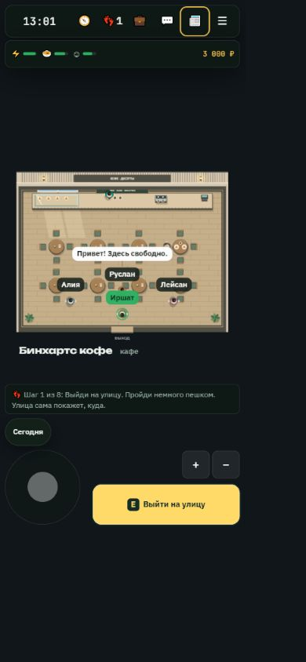
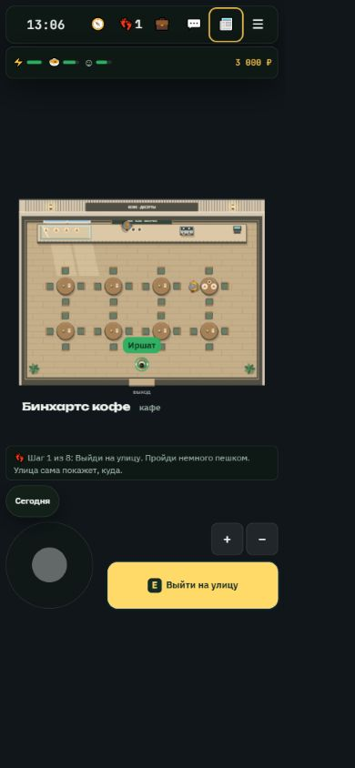
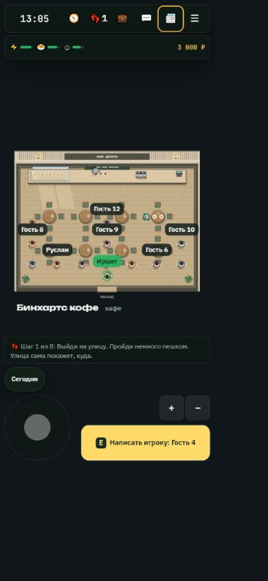
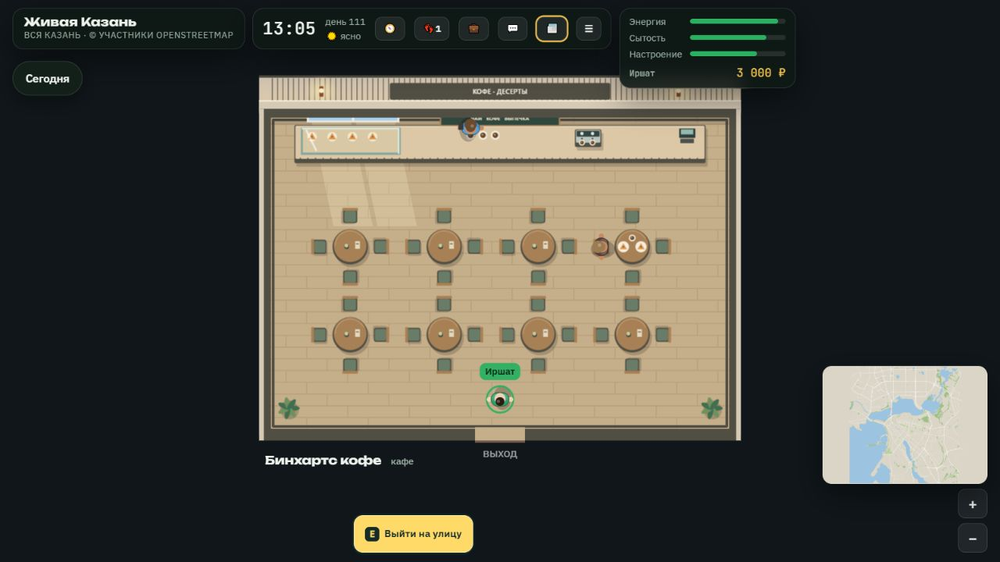
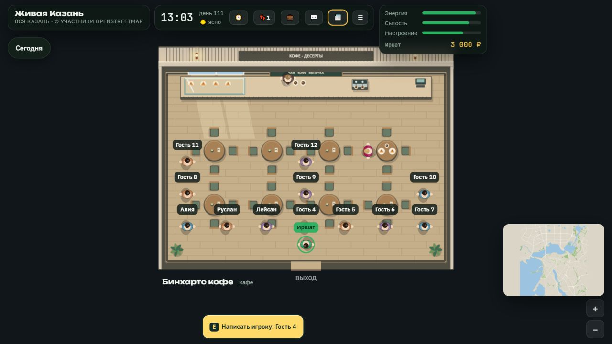

# Проверка общих заведений

База: `bdb72c7`. 178/178 Node-проверки, 95 JS-файлов прошли синтаксическую проверку, 11 сетевых сценариев прошли на настоящем изолированном Node-сервере. Ручная проверка двух браузерных клиентов: встреча, речь в кафе, изоляция соседнего заведения.

Снимки ниже сняты через CUA на общей фикстуре `shared-venues-fixtures.js`. Это не результат полного `shots.js`. Телефон: CSS viewport 390×844 в iframe, компьютер: 1280×720. На основной ветке сетевые гости внутри не отображаются. Состав случайных NPC и часы могут различаться.

Стандартный `shots.js` заблокирован запуском Chromium (`spawn EPERM`), `perf.js` — ошибкой Node/Undici до измерений. Пробные скрытые страницы на прежней базе 00a3240 дали 6–9 кадров за 5 секунд; эти значения не подтверждают скорость игры и не используются как сравнение. Все одиннадцать браузерных наборов (включая citymemory.js), 90 снимков на сборку и perf ×3 остаются для приёмки у основного инженера.

| Сцена | До | После |
|---|---|---|
| Телефон: три гостя |  |  |
| Телефон: 12 гостей |  |  |
| Компьютер: три гостя |  |  |
| Компьютер: 12 гостей |  |  |
